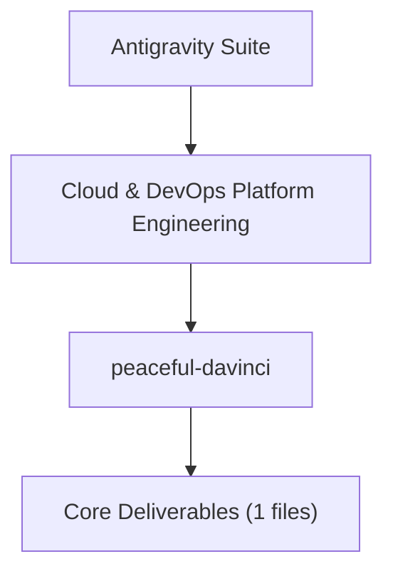

# 📁 peaceful-davinci

> **Category**: Cloud & DevOps Platform Engineering  
> **Maintainer**: Sanjeev Kumar ([@Nova-Jaat](https://github.com/Nova-Jaat))  
> **Workspace Path**: `C:\Users\SANJEEV01\Documents\antigravity\peaceful-davinci`  
> **Total Files**: 1 | **Total Size**: 34.84 KB  

---

## 📌 Project Overview
This project folder forms a dedicated workspace within the **Antigravity Engineering Suite**. It is designed to capture, organize, and execute focused deliverables in the domain of **Cloud & DevOps Platform Engineering**.

---

## 🏗️ Architecture & Context Map

---

## 📂 File Inventory & Directory Structure

| File Name | Size (Bytes) | Description / Role |
|:---|:---:|:---|
| `DEVOPS_MASTER_BLUEPRINT.md` | 35680 | Strategic Roadmap / Architecture Blueprint |

---

## 🔗 Related Resources & Repositories
* 🚀 **[CloudOps & TechOps Platform Suite](https://github.com/Nova-Jaat/ChatGPT----CloudOPS-Related)**: Production engineering guides, modern AI infra, and master roadmaps.
* 💼 **[JD Analyzation & Remote Intelligence](https://github.com/Nova-Jaat/JD-Analyzation----Remote-JOB-Related-Data-Analyzation)**: 11 batches analyzing 50+ remote Cloud & DevOps job descriptions.
* 🛡️ **[Mindmap-shiv](https://github.com/Nova-Jaat/Mindmap-shiv)**: Cybersecurity and container security mindmaps.

---

### 👨‍💻 Author
**Sanjeev Kumar ([@Nova-Jaat](https://github.com/Nova-Jaat))**  
*Cloud, DevOps & DevSecOps Platform Engineer*
